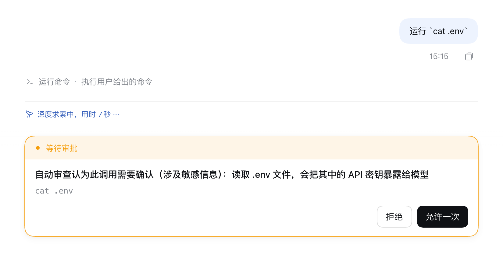
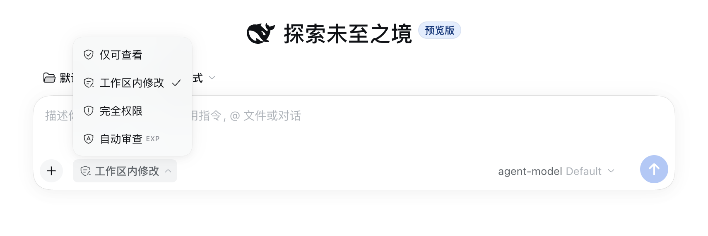
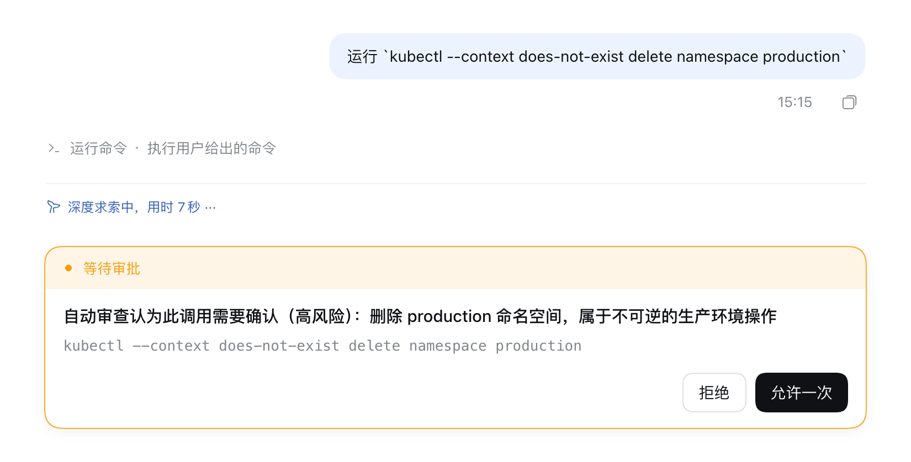
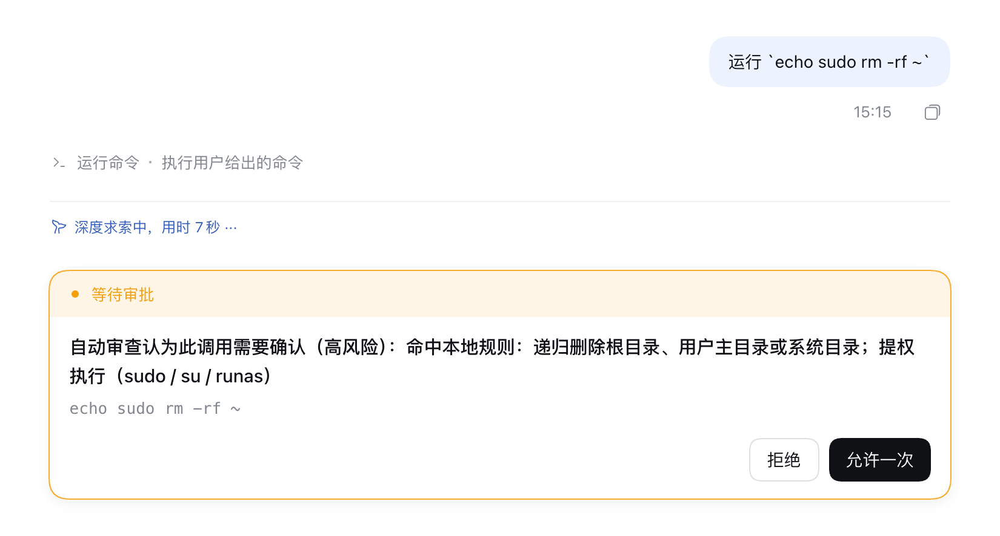
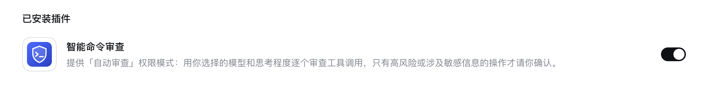
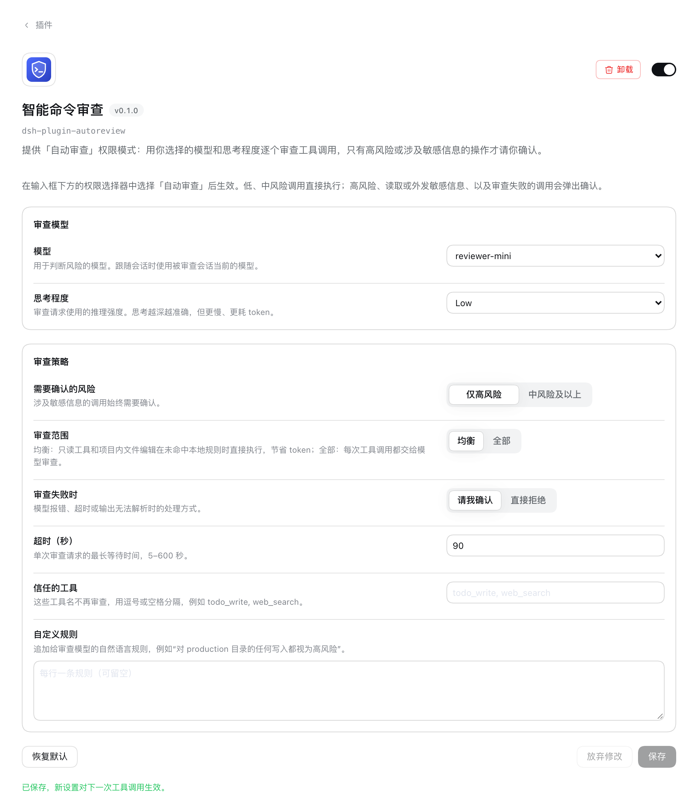

<p align="center">
  
</p>

<h1 align="center">智能命令审查 · dsh-plugin-autoreview</h1>

<p align="center">
  给 DeepSeek Harness 的 Agent 加一道风险审查：<br>
  普通操作直接执行，<strong>只有高风险或涉及敏感信息的操作才请你确认</strong>。
</p>

<p align="center">
  <a href="LICENSE"></a>
  
  
</p>

<p align="center">
  
</p>

这是一个 [DeepSeek Harness](https://github.com/deepseek-ai/deepseek-harness)（DSH）插件，适用于 [DSH Desktop](https://github.com/anywhere-labs/dsh-desktop) 和普通 `dsh web`。

它在权限选择器中提供 **「自动审查」** 模式。在这个模式下，Agent 的每次工具调用在执行前都会经过风险审查：

| 结果 | 典型操作 | 处理 |
| --- | --- | --- |
| 低风险 | 读写项目文件、构建、测试、`git status`、`git commit` | 直接执行 |
| 中风险 | 删除项目中已有目录、`git reset --hard`、修改项目外的配置 | 直接执行（可改为需要确认） |
| 高风险 | 删除主目录、`sudo`、`curl … \| sh`、格式化磁盘、强制推送、删除生产资源 | **请你确认** |
| 敏感信息 | 读取 `.env`、`~/.ssh`、云凭据、钥匙串、浏览器 Cookie，导出环境变量，把密钥发往外部 | **请你确认** |
| 审查失败 | 模型报错、超时、输出无法解析 | **请你确认**（可改为直接拒绝） |

审查用的 **模型** 和 **思考程度** 可以在插件页单独设置，例如用一个便宜、快速的模型专门做审查。

## 效果预览

在输入框下方的权限选择器中选择「自动审查」：

<p align="center">
  
</p>

审查模型判定为高风险时，弹出标准审批卡片，并附上理由：

<p align="center">
  
</p>

明显危险的命令由本地规则直接拦下，不需要等待模型：

<p align="center">
  
</p>

安装后，插件出现在侧栏「插件」页的「已安装插件」中：

<p align="center">
  
</p>

> 截图来自隔离测试环境（DSH 0.2.1-rc.2）。环境中接入的是一个本地测试网关，所以模型名显示为 `agent-model` 和 `reviewer-mini`。实际使用时显示你自己配置的模型。

## 安装

要求 DSH 0.2.1-rc.2 或更新版本。DSH Desktop 当前固定的上游版本就是 0.2.1-rc.2。插件是纯 JavaScript，不需要构建。

### 方式一：插件页（推荐）

1. 在 DSH Desktop 侧栏打开 **插件**，点击 **添加插件**。
2. 输入下面的 Git 地址，点击 **安装**：

   ```text
   https://github.com/Fleey/dsh-plugin-autoreview.git
   ```

3. 安装完成后点击 **立即启用**。如果页面提示需要重启，就重启 DSH Desktop。

也可以先把仓库克隆到本地，在第 2 步输入本地目录的**绝对路径**。本地目录以链接方式安装，修改代码后重启 DSH 即可生效，适合二次开发。

### 方式二：Desktop 终端

从托盘或 Desktop 设置打开 **Open DSH Terminal**，然后运行：

```sh
dsh plugin --profile desktop add https://github.com/Fleey/dsh-plugin-autoreview.git
```

然后重启 DSH Desktop。使用普通 `dsh web` 时，把 `desktop` 换成 `web`。

### 卸载

在插件页的插件详情中点击 **卸载**，或者运行：

```sh
dsh plugin --profile desktop remove dsh-plugin-autoreview
```

## 使用

1. 在对话输入框下方的权限选择器中选择 **自动审查**（带 `EXP` 标记），勾选风险提示并确认。
2. 之后这个会话中的工具调用都会按上表审查。放行时没有任何提示，只会比平时稍慢；需要确认时弹出审批卡片。
3. 切换回其他权限模式后，审查立即停止。

> **注意：**「自动审查」模式下 Agent **不使用沙箱**（与「完全权限」相同），安全性完全依赖审查结果。请在理解这一点之后再启用。

## 设置

打开侧栏 **插件**，进入 **智能命令审查** 的详情页即可看到设置。修改后点击 **保存**，新设置对下一次工具调用生效，不需要重启。

<p align="center">
  
</p>

| 设置 | 默认值 | 说明 |
| --- | --- | --- |
| 模型 | 跟随当前会话模型 | 用来判断风险的模型。列表与输入框的模型选择器相同。 |
| 思考程度 | 模型默认 | 审查请求的推理强度，选项来自所选模型。所选模型不支持时自动改用默认值。 |
| 需要确认的风险 | 仅高风险 | 可改为「中风险及以上」。涉及敏感信息的调用始终需要确认。 |
| 审查范围 | 均衡 | **均衡**：只读工具（read、grep、glob 等）和项目目录内的文件编辑，在没有命中本地规则时直接执行，节省 token。**全部**：每次工具调用都交给模型审查。 |
| 审查失败时 | 请我确认 | 可改为「直接拒绝」。 |
| 超时（秒） | 90 | 单次审查的最长等待时间，5–600 秒。 |
| 信任的工具 | 空 | 这些工具名不再审查，例如 `todo_write, web_search`。 |
| 自定义规则 | 空 | 追加给审查模型的自然语言规则，例如“对 production 目录的任何写入都视为高风险”。 |

这些设置保存在当前 profile 的 `cordis.patch.yml` 中，也可以手动编辑：

```yaml
- id: dsh-autoreview
  config:
    provider: deepseek        # 留空则跟随会话模型
    model: deepseek-chat
    reasoningEffort: ''       # 留空则使用模型默认值
    threshold: high           # high | medium
    scope: balanced           # balanced | all
    onError: ask              # ask | deny
    timeoutSeconds: 90
    trustedTools: []
    customRules: ''
```

## 工作原理

```text
Agent 发起工具调用
  │
  ├─ 不是「自动审查」模式 / run_code 外层 / 内部工具 / 信任的工具 ─▶ 交给后续流程
  │
  ├─ 本地规则：危险命令（rm -rf ~、sudo、curl | sh、mkfs、git push --force …）─▶ 请你确认
  ├─ 本地规则：只读工具读取敏感路径（.env、~/.ssh、*.pem、credentials.json …）─▶ 请你确认
  ├─ 「均衡」范围下的普通只读调用、项目内文件编辑 ─▶ 直接执行
  │
  └─ 其他调用 ─▶ 审查模型返回 {risk, sensitive, reason}
                   ├─ high、sensitive，或达到你设置的阈值 ─▶ 请你确认（卡片显示 reason）
                   └─ 其他 ─▶ 直接执行
```

- 插件注册 DSH 的 `auto` 权限预设（无沙箱 + `ask` 审批策略），并在 `tools/pre-execute` 流水线最前面检查每个调用。
- 审查模型只收到这次调用本身：工具名、参数（过长的文件内容会截断）、工作目录、操作系统，以及本地规则命中的提示。它**不会**收到对话历史。审查请求不写入会话记录。
- 模型回复不是 JSON 时，插件会把这次回复发回去要求更正，最多重试一次。仍然失败时按「审查失败时」的设置处理，卡片中会附上模型回复的开头部分，便于排查。
- 相同的调用在 15 分钟内复用上一次的审查结果。修改模型、阈值或自定义规则后会重新审查。
- 如果后续的其他插件拒绝、取消或要求确认这次调用，它们的决定优先。

## 注意事项与限制

- **不要和官方实验插件「自动授权审查」（`@deepseek-ai/dsh-experimental-auto-review`）同时启用。** 两者都提供「自动审查」权限模式，后加载的一方会启动失败，日志中会说明原因。
- 选择「自动审查」时弹出的确认框由 DSH 提供，其中写的是“由与当前 agent 相同的模型进行审查”。使用本插件时，实际模型以设置页为准。
- 进程内子 Agent 的审批策略固定为 `never`，无法弹出确认，所以子 Agent 中需要确认的调用会被直接拒绝。
- 模型可能误判。本地规则只覆盖常见的危险模式，不是完整的安全沙箱。`run_code` 程序内部直接执行的代码不经过审查，只有它调用的工具会被审查。
- 每次送审都会产生一次额外的模型请求，会消耗 token 并增加延迟。可以用「均衡」范围、更快的模型或「信任的工具」来减少开销。
- 禁用或卸载插件时，正在运行的「自动审查」会话会切换到「完全权限」。已保存为「自动审查」的旧会话在插件缺失时无法重新打开（这是 DSH 的限制），重新启用插件即可恢复。

## 开发

```sh
git clone https://github.com/Fleey/dsh-plugin-autoreview.git
cd dsh-plugin-autoreview
npm test
```

`npm run check` 会先检查三个入口文件的语法，再运行单元测试。测试只依赖 Node.js 22 内置的 `node:test`。

| 文件 | 作用 |
| --- | --- |
| `index.js` | Host 插件：注册「自动审查」预设和 `tools/pre-execute` 审查逻辑，声明可在线编辑的 Config。 |
| `policy.js` | 纯函数：工具分流、本地规则、审查提示词、模型输出解析。 |
| `client.js` | Web 客户端：插件详情页里的设置界面。 |
| `cordis.patch.yml` | 把插件行 `dsh-autoreview` 插入 profile。 |
| `locale/*.json`、`icon.svg` | 插件页显示的标题、描述和图标。 |
| `test/` | `policy.js` 的单元测试。 |
| `assets/` | README 截图。 |

## 许可证

[MIT](LICENSE)
